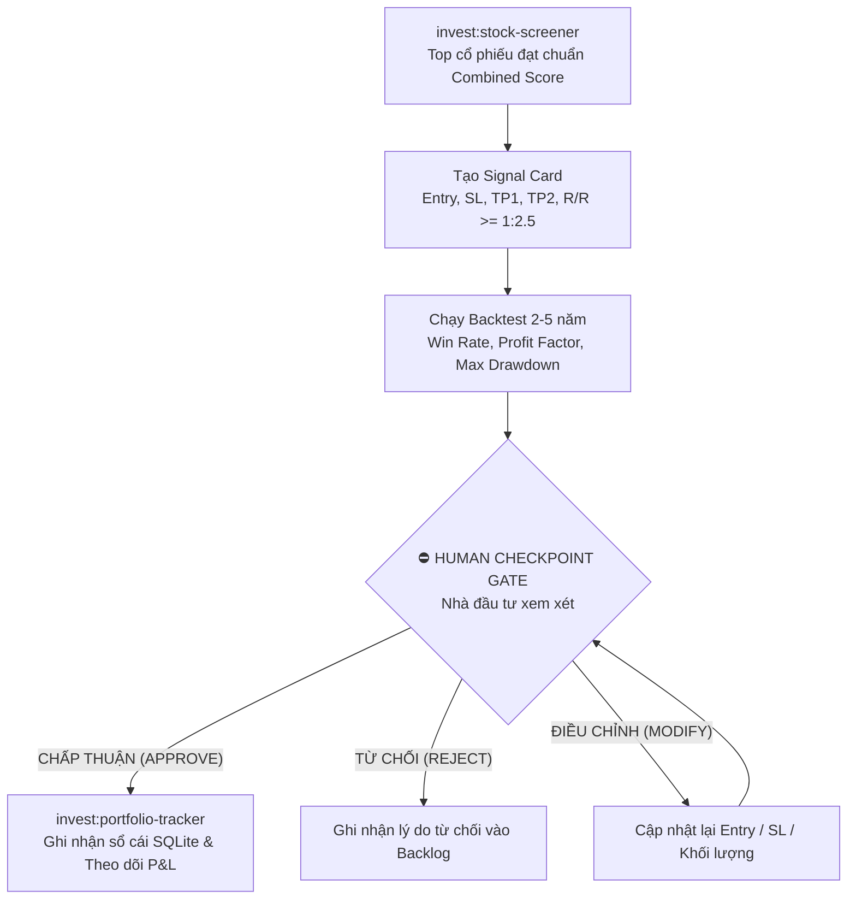

# `invest:signal-agent` — TẠO TÍN HIỆU, KIỂM THỬ ĐỊNH LƯỢNG & HUMAN CHECKPOINT GATE

## 1. NGUYÊN TẮC CỐT LÕI
> **"Chỉ kích hoạt vị thế khi có sự đồng thuận giữa Yếu Tố Chu Kỳ VÀ Mô Hình Sóng Elliott."**
> **"AI chỉ đóng vai trò phân tích và đề xuất — TUYỆT ĐỐI KHÔNG TỰ ĐỘNG ĐẶT LỆNH khi chưa có sự xác nhận của Nhà đầu tư qua Human Checkpoint Gate."**

---

## 2. QUY CHUẨN THIẾT KẾ SIGNAL CARD

Mỗi tín hiệu giao dịch được đóng gói thành một **Signal Card** chuẩn hóa gồm 8 trường dữ liệu bắt buộc:

1. **Mã Tài Sản:** Mã chứng khoán / Crypto / Hàng hóa (VD: `FPT`, `SIP`, `BTCUSD`, `XAUUSD`).
2. **Loại Vị Thế:** `MUA (BUY LIMIT / BUY STOP)` hoặc `BÁN (SELL SHORT / CANH BÁN HỒI)`.
3. **Vùng Canh Lệnh (Entry Zone):** Mức giá kích hoạt tối ưu (thường là vùng kiểm định Fibo Retracement 0.500 - 0.618 hoặc MA20).
4. **Điểm Vô Hiệu Hóa Kịch Bản (Stop Loss):** Mức giá cắt lỗ bắt buộc (đặt dưới đáy Sóng 2 hoặc Sóng C đối với lệnh Mua; đặt trên đỉnh Sóng B hoặc Sóng 5 đối với lệnh Bán).
5. **Mục Tiêu Chốt Lời (Take Profit):**
   * **TP1:** Vùng cản Fibo Retracement hoặc đỉnh sóng gần nhất (Chốt 50% vị thế, dời SL về hòa vốn).
   * **TP2:** Vùng mở rộng Fibo Extension 1.272 – 1.618 (Chốt phần còn lại).
6. **Tỷ Lệ Risk / Reward (R/R):** Bắt buộc $R/R \ge 1 : 2.5$ (Lợi nhuận kỳ vọng tối thiểu gấp 2.5 lần rủi ro chấp nhận).
7. **Lý Do Kỹ Thuật & Sóng:** Đối soát cấu trúc sóng Elliott, MACD, và chu kỳ thời gian.
8. **Quy Mô Vị Thế Đề Xuất (Position Sizing):** Tối đa 15% – 20% NAV tổng thể, rủi ro mỗi lệnh $\le 2\%$ NAV.

---

## 3. ENGINE KIỂM THỬ ĐỊNH LƯỢNG (BACKTEST ENGINE)

Trước khi gửi Signal Card cho Nhà đầu tư phê duyệt, hệ thống chạy thuật toán Backtest định lượng trên chuỗi dữ liệu nến lịch sử 2 – 5 năm của tài sản để đánh giá hiệu suất mô hình:

### Các chỉ số định lượng bắt buộc:
* **Win Rate (%):** Tỷ lệ lệnh thắng / tổng số lệnh thực hiện (Yêu cầu $\ge 55\%$).
* **Profit Factor (Tỷ số sinh lời):** $\frac{\text{Tổng Lãi}}{\text{Tổng Lỗ}}$ (Yêu cầu $\ge 1.8$).
* **Max Drawdown (%):** Mức sụt giảm tài sản lớn nhất từ đỉnh (Yêu cầu $< 12\%$).
* **Average R/R đạt được:** Tỷ lệ lãi trung bình / lỗ trung bình thực tế.

---

## 4. QUY TRÌNH DUYỆT LỆNH: HUMAN CHECKPOINT GATE (HITL)

* **Cửa ngõ an toàn:** Nhà đầu tư trực tiếp bấm duyệt lệnh trên giao diện Web / Streamlit hoặc xác nhận qua câu lệnh.
* **Không bao giờ tự ý giao dịch:** Bảo vệ tuyệt đối an toàn tài khoản và tuân thủ nguyên tắc quản trị rủi ro cá nhân.

