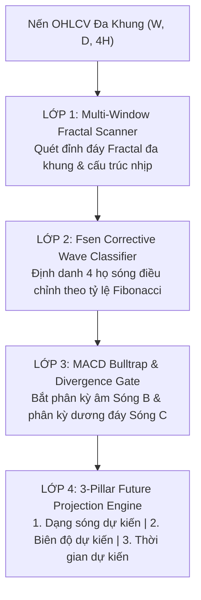

# INVEST: WAVE ANALYST AGENT v2.0 PRO
## Trạm Đếm Sóng Elliott & Định Danh Các Bộ Sóng Điều Chỉnh Chuẩn Fsen

> **Chuẩn hóa theo MICRO Framework (Model • Instruction • Context • Rules • Output)**  
> *Nguyên tắc cốt lõi: 'Chỉ vào lệnh khi có Sóng & Chu kỳ' — Phân biệt rạch ròi Sóng Đẩy (Impulse) vs Sóng Điều Chỉnh (Correction), chống bẫy giá Bulltrap Sóng B bằng phân kỳ MACD và đo lường thời gian tương lai bằng chu kỳ Fibonacci Time.*

---

## 1. Mô Thức Vận Hành 4 Lớp (Model & Instruction)

Trạm **`invest:wave-analyst`** v2.0 Pro vận hành bộ máy phân tích sóng đa tầng, tự động bóc tách nến qua 4 lớp chuyên sâu:



---

## 2. Cẩm Nang 4 Họ Sóng Điều Chỉnh Fsen (Corrective Wave Taxonomy)

Căn cứ tài liệu nội bộ `Tổng hợp lý thuyết Sóng.xlsx`, `2.3 FIBONACCI.pdf` và `1.3 PHA - NHỊP.pdf`:

### 2.1. Họ Sóng Zigzag (Cấu trúc 5-3-5) — Nhịp Chỉnh Dốc & Sâu
- **Đặc điểm:** Thường xuất hiện ở **Sóng 2** của sóng đẩy hoặc Sóng A/B của mô hình lớn.
- **Phân loại:**
  1. **Regular Zigzag (Zigzag Chuẩn):** Sóng B thoái lui nông $38.2\% - 66.7\%$ Sóng A; Biên độ Sóng C xấp xỉ Sóng A ($C \approx A$).
  2. **Extended Zigzag (Zigzag Kéo Dài):** Sóng C mở rộng mạnh đạt $1.618 \times A$ (Thiết luật Fsen: $C$ kéo dài nhưng **không được vượt quá $3.0 \times A$**).
  3. **Running Zigzag (Zigzag Cụt):** Thị trường quá mạnh, Sóng C kết thúc sớm mà không phá được đáy Sóng A.

### 2.2. Họ Sóng Flat (Cấu trúc 3-3-5) — Nhịp Chỉnh Đi Ngang (Sideway)
- **Đặc điểm:** Thường xuất hiện ở **Sóng 4** của sóng đẩy hoặc Sóng B của Zigzag.
- **Phân loại:**
  1. **Regular Flat (Flat Thường):** Sóng B hồi sâu đạt $90\% - 105\%$ Sóng A; Sóng C về lại vùng đáy Sóng A ($C \approx A$).
  2. **Expanded Flat (Flat Mở Rộng — Bẫy Margin Bulltrap):**
     - Sóng B vượt qua điểm bắt đầu của Sóng A ($B > 1.05 \times A$).
     - Sóng C xả cực mạnh thủng đáy Sóng A ($C \ge 1.618 \times A$).
     - *Đây là mô hình nhà cái ép margin call ác liệt nhất!*
  3. **Running Flat (Flat Chạy):** Sóng B vượt đỉnh Sóng A, nhưng sau đó Sóng C cụt không thủng đáy Sóng A do lực cầu quá khỏe.

### 2.3. Họ Sóng Tam Giác (Cấu trúc 3-3-3-3-3: A-B-C-D-E) — Tích Lũy Nén Chặt
- **Đặc điểm:** Thường xuất hiện ở **Sóng 4** hoặc **Sóng B**. Không bao giờ xuất hiện ở Sóng 2.
- **Phân loại:**
  1. **Tam Giác Thu Hẹp (Contracting Triangle):** Biên độ các sóng con suy giảm dần ($A > B > C > D > E$), 2 đường trendline co cụm về một góc nhọn. Sau khi phá vỡ sóng E, giá bùng nổ theo hướng xu hướng trước đó.
  2. **Tam Giác Mở Rộng (Expanding Triangle):** Biên độ mở rộng dần ($A < B < C < D < E$), chỉ bao gồm các sóng con họ Zigzag.

### 2.4. Sóng Điều Chỉnh Phức Tạp (Complex Combination: W-X-Y)
- Xuất hiện khi thị trường cần điều chỉnh một chu kỳ lớn hoặc sau một nhịp tăng/giảm quá sốc.
- **Double Zigzag (W-X-Y):** Sóng W là Zigzag, X là sóng hồi ngắn nối, Y là Zigzag tiếp diễn. Sóng X không được vượt qua điểm bắt đầu của W.
- **Double Three (W-X-Y):** W và Y không thể cùng là Zigzag (nếu W là Zigzag thì Y phải là Flat hoặc Tam giác).

---

## 3. Thiết Luật Bất Biến & Bộ Lọc Phân Kỳ MACD Fsen

### 🎯 Quy Tắc 1 — Thiết Luật Kết Thúc Sóng C
> *"Kết thúc của 1 mô hình điều chỉnh luôn là sóng C (PHẢI CÓ ĐỦ 5 SÓNG CON - Trừ mô hình tam giác)."*
- **Ý nghĩa:** Không bao giờ được bắt đáy sớm khi nhịp điều chỉnh mới chỉ đi được 3 sóng con (A-B-C ngắn hạn). Phải chờ Sóng C hoàn thành đủ 5 vi sóng (1-2-3-4-5 con).

### 🎯 Quy Tắc 2 — Bộ Lọc Phân Biệt Sóng B Bulltrap vs Sóng 3 Đẩy
> *"Trong trường hợp có sóng lên vượt đỉnh sóng 1: Để phân biệt đó là sóng lên (Sóng 3) hay là Sóng B thì dựa vào phân kỳ. NẾU CÓ PHÂN KỲ THÌ ĐÓ LÀ SÓNG B."*
- **Quy trình kiểm soát:** Khi giá bứt phá vượt đỉnh cũ:
  - Nếu MACD Histogram tạo đỉnh cao mới đồng thuận $\implies$ Xác nhận **SÓNG 3 MỞ RỘNG**, gia tăng tỷ trọng!
  - Nếu MACD Histogram tạo đỉnh thấp hơn (Phân kỳ âm) $\implies$ Khẳng định **BẪY SÓNG B BULLTRAP (Expanded Flat)**, lập tức bán chốt lời hoặc đứng ngoài để tránh cú xả Sóng C!

### 🎯 Quy Tắc 3 — Thợ Săn Đáy Sóng C (C-Wave Exhaustion Hunter)
- Khi giá lao dốc tạo đáy mới ở Sóng C nhưng MACD Histogram tạo đáy cao hơn (Phân kỳ dương) và Histogram co cụm chuyển từ đỏ sang xanh $\implies$ Kích hoạt điểm mua **Sniper Entry** đón đầu chân Sóng đẩy mới!

---

## 4. Hộp Dự Báo Tương Lai 3 Thành Tố (3-Pillar Future Projection)

Khi xuất báo cáo hoặc hiển thị trên biểu đồ, trạm `invest:wave-analyst` bắt buộc xuất bản đủ 3 thành tố:

```
┌─────────────────────────────────────────────────────────────────────────────┐
│ 🔷 HỘP DỰ BÁO SÓNG FSEN (FUTURE PROJECTION SUITE)                           │
├─────────────────────────────────────────────────────────────────────────────┤
│ 1. DẠNG SÓNG DỰ KIẾN:                                                       │
│    • Loại hình: Sóng tuần dự kiến là Zigzag [5-3-5] (hoặc Flat, Impulse...) │
│    • Cấu trúc sóng con: (1)-(2)-(3)-(4)-(5) hoặc (A)-(B)-(C)                │
├─────────────────────────────────────────────────────────────────────────────┤
│ 2. BIÊN ĐỘ DỰ KIẾN:                                                         │
│    • Invalidation Level: Mức giá vô hiệu hóa kịch bản (Vượt/Thủng = HỦY)   │
│    • Sóng 3?: Mục tiêu Fibo Extension 1.618 hoặc -0.5 / -0.618 (Vùng PRZ)   │
│    • Sóng 4?: Thoái lui 38.2% từ Sóng 3                                    │
│    • Sóng 5?: Mục tiêu Fibo Extension 1.000 hoặc -1.0 (Vùng PRZ)            │
│    • Chuỗi phục hồi ABC: Mục tiêu A?, B?, C? sau khi hoàn thành 5 sóng     │
├─────────────────────────────────────────────────────────────────────────────┤
│ 3. THỜI GIAN DỰ KIẾN (FIBONACCI TIME CYCLE):                                │
│    • Tương quan: T3 = T2 + 1.618 x T1 | T4 = T3 + 1.000 x T2 | T5 = T4 + T1 │
│    • Điểm rơi thời gian: Tháng/Năm và Quý cụ thể hoàn thành từng sóng       │
└─────────────────────────────────────────────────────────────────────────────┘
```

---

## 5. Tài Nguyên & Script Thực Thi
- **Script phân tích động:** `.agents/skills/invest-wave-analyst/scripts/wave_analyzer_engine.py`
- **Bộ máy dự báo tương lai:** `invest_fsen_projection_engine.py`
- **Ma trận đầu ra:** `outputs/investment/corrective_wave_matrix.json` & `outputs/investment/fsen_projection_suite.json`
- **Chỉ báo Pine Script v6:** `knowledge-base/AGY_Fsen_Elliott_Scanner.pine`
