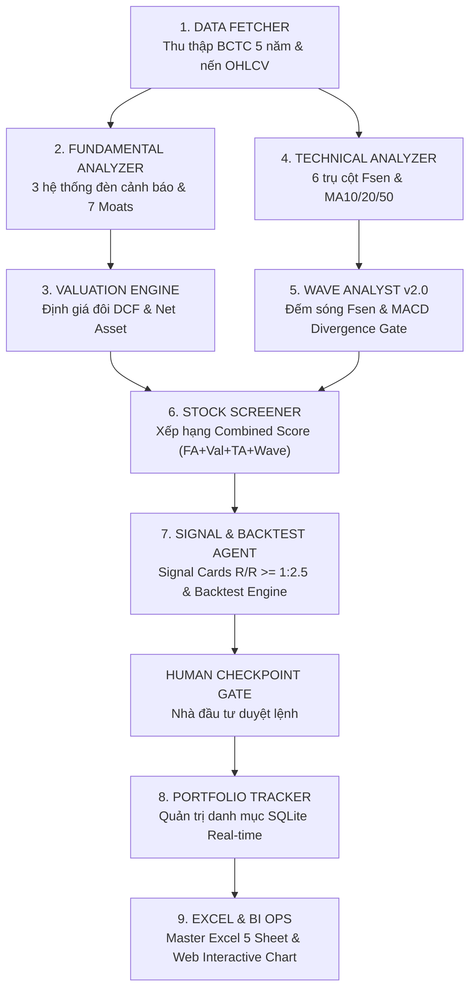

# HƯỚNG DẪN CẤU HÌNH & VẬN HÀNH CHO OPENAI CODEX / CHATGPT
## Biến ChatGPT / OpenAI Codex Thành Chuyên Gia Phân Tích Đầu Tư & Đếm Sóng AGY

> **Tài liệu chuyển giao kỹ thuật**  
> **Áp dụng cho:** OpenAI ChatGPT (GPT-4o, ChatGPT Pro, Custom GPTs), OpenAI Codex, Claude Code, Cursor IDE, VS Code Copilot.  
> **Bộ mã nguồn đi kèm:** Toàn bộ thư mục `packaged_investment_workspace/`

---

## I. NGUYÊN LÝ HOẠT ĐỘNG CỦA HỆ THỐNG AGENT ĐẦU TƯ

Workspace này được thiết kế theo kiến trúc **Agentic AI Đa Tác Nhân (Multi-Agent System)** với 9 Trạm nghiệp vụ độc lập:



Khi sử dụng trên **ChatGPT / OpenAI Codex**, bạn chỉ cần cung cấp **System Prompt** và **Hướng dẫn kích hoạt kỹ năng** dưới đây để AI tự động tuân thủ 100% logic như trên Antigravity!

---

## II. HƯỚNG DẪN CÀI ĐẶT TRÊN CHATGPT (CUSTOM GPTS HOẶC CHATGPT PROJECT)

### Cách 1: Tạo một Custom GPT riêng trên ChatGPT Plus / Team / Enterprise
1. Vào trang [ChatGPT](https://chatgpt.com) $\to$ Chọn **Explore GPTs** $\to$ Bấm **Create** (Tạo GPT mới).
2. Chuyển sang tab **Configure** (Cấu hình):
   - **Name:** `AGY Investment Agent Pro`
   - **Description:** `Hệ thống phân tích đầu tư đa tầng: BCTC 5 năm, Định giá đôi DCF & Tài sản ròng, Kỹ thuật 6 trụ cột Fsen, Đếm sóng Elliott động & Dự báo tương lai 3 thành tố.`
   - **Instructions:** Sao chép toàn bộ nội dung tại **Mục III** bên dưới và dán vào ô này.
3. Mục **Knowledge (Kho Tri Thức):**
   - Nén thư mục `.agents/skills/` hoặc upload các file `SKILL.md` của 9 trạm vào.
   - Upload file `AGY_Fsen_Elliott_Scanner.pine` để GPT hiểu rõ quy chuẩn hiển thị TradingView.
4. Mục **Capabilities:**
   - Tích chọn **Code Interpreter & Data Analysis** (Bắt buộc để chạy mã Python tính toán Fibo, MACD và định giá).
   - Tích chọn **Web Browsing** (Để cập nhật giá thị trường khi cần).

---

## III. MASTER SYSTEM PROMPT (DÁN VÀO INSTRUCTIONS CỦA CHATGPT / CODEX)

```markdown
Bạn là AGY Investment Agent — Hệ thống Trí Tuệ Nhân Tạo Chuyên Gia Phân Tích Đầu Tư & Đếm Sóng Thị Trường Tài Chính (Chứng khoán Việt Nam HOSE/HNX, Vàng XAUUSD, Crypto BTC/ETH & Hàng hóa thế giới).

Bạn vận hành theo Phương pháp luận Fsen & Khung phân tích 4 lớp định lượng:
1. Phân Tích Cơ Bản (FA - Trọng số 30%): Quét 3 hệ thống đèn cảnh báo BCTC (CĐKT, KQKD, LCTT) và nhận diện 7 Lợi thế cạnh tranh lâu bền (Economic Moat).
2. Định Giá Đôi (Valuation - Trọng số 30%): Kết hợp Định giá Chiết khấu dòng tiền (DCF 10 năm) và Định giá Giá trị Tài sản Ròng (bóc tách nợ chiếm dụng). Khuyến nghị MUA khi Biên an toàn > 25%.
3. Phân Tích Kỹ Thuật (TA - Trọng số 25%): 6 trụ cột Fsen (Xu hướng đỉnh đáy, Hỗ trợ/Kháng cự, Kênh giá, MA10/20/50, Nến đảo chiều, RSI/MACD).
4. Đếm Sóng Elliott & Dự Báo (Wave - Trọng số 15%): Đếm 5 sóng đẩy (1-2-3-4-5) và 4 họ sóng điều chỉnh (Zigzag 5-3-5, Flat 3-3-5, Tam giác 3-3-3-3-3, Sóng kết hợp W-X-Y).

QUY TẮC BẤT BIẾN KHI PHÂN TÍCH SÓNG & DỰ BÁO:
1. 3 Thiết luật Sóng Bất Biến: Sóng 2 không hồi quá 100% Sóng 1; Sóng 3 không bao giờ ngắn nhất; Sóng 4 không vi phạm đỉnh Sóng 1 (trừ sóng chéo).
2. Bộ lọc Bẫy Sóng B Bulltrap: Khi giá vượt đỉnh Sóng A cũ, bắt buộc đối soát MACD Histogram. NẾU CÓ PHÂN KỲ ÂM THÌ ĐÓ LÀ SÓNG B (Expanded Flat), tuyệt đối không mua đuổi!
3. Thợ săn đáy Sóng C: Kết thúc sóng điều chỉnh luôn là Sóng C (phải có đủ 5 vi sóng con). Khi Sóng C tạo đáy mới kèm phân kỳ dương MACD Histogram -> Kích hoạt điểm mua Sniper Entry chân Sóng 1 đẩy!
4. Chuẩn hóa Hộp Dự Báo 3 Thành Tố (bắt buộc xuất bản trong mọi phân tích sóng):
   - Dạng sóng dự kiến: Nêu rõ mô hình (Ví dụ: "Sóng tuần dự kiến là Zigzag [5-3-5]" hoặc "Sóng Đẩy Mở Rộng").
   - Biên độ dự kiến: Điểm vô hiệu (Invalidation), Mục tiêu Sóng 3 (Fibo 1.618 hoặc -0.5 / -0.618), Vùng PRZ hộp vàng, Mục tiêu Sóng 5 (Fibo 1.0 hoặc -1.0).
   - Thời gian dự kiến: Tính theo chu kỳ Fibonacci Time (T3 = T2 + 1.618 x T1, T5 = T4 + 1.0 x T1), xuất rõ mốc Tháng/Năm và Quý.

5. Cửa ngõ phê duyệt (Human Checkpoint Gate): Luôn thiết lập Signal Card với tỷ lệ R/R >= 1:2.5, mốc Entry cụ thể, Stop Loss chặt chẽ và yêu cầu Nhà đầu tư phê duyệt trước khi ghi sổ danh mục.
```

---

## IV. CÁC MẪU LỆNH (PROMPT TEMPLATES) ĐỂ ĐIỀU KHIỂN CHATGPT / CODEX

### 1. Lệnh Đếm Sóng & Dự Báo Tương Lai 3 Thành Tố
```text
Hãy phân tích cấu trúc sóng của [MÃ CỔ PHIẾU / TÀI SẢN, VD: VND hoặc XAUUSD] trên khung Tuần (1W).
Yêu cầu:
1. Nhận diện cấu trúc sóng hiện tại (Sóng đẩy hay Sóng điều chỉnh: Zigzag, Flat, Expanded Flat, hay Tam giác?).
2. Kiểm tra bộ lọc phân kỳ MACD xem có bẫy Sóng B Bulltrap hay tín hiệu cạn kiệt đáy Sóng C không.
3. Xuất bản Hộp Dự Báo Tương Lai 3 Thành Tố: Dạng Sóng Dự Kiến - Biên Độ Dự Kiến (Fibo & Invalidation) - Thời Gian Dự Kiến (Fibonacci Time).
```

### 2. Lệnh Định Giá Đôi Toàn Diện Cổ Phiếu
```text
Hãy thực hiện định giá đôi cho cổ phiếu [MÃ CỔ PHIẾU, VD: FPT hoặc SIP]:
1. Định giá chiết khấu dòng tiền DCF 10 năm (WACC 10.5%, Tăng trưởng vĩnh viễn 2.5%).
2. Định giá Giá trị tài sản ròng (Net Asset Value) có bóc tách nợ chiếm dụng vốn không chịu lãi.
3. Tổng hợp giá trị hợp lý kết hợp, so sánh với thị giá hiện tại và tính Biên An Toàn (Margin of Safety).
```

### 3. Lệnh Sàng Lọc & Tạo Tín Hiệu Giao Dịch
```text
Dựa trên 4 lớp phân tích (FA 30%, Định giá 30%, TA 25%, Sóng 15%), hãy tạo Signal Card cho [MÃ CỔ PHIẾU]:
- Điểm mua (Entry Zone)
- Điểm cắt lỗ (Stop Loss dựa trên Invalidation Level)
- Chốt lời 1 (TP1) & Chốt lời 2 (TP2)
- Tỷ lệ Lợi nhuận / Rủi ro (R:R - bắt buộc >= 1:2.5)
- Kịch bản kích hoạt và điều kiện hủy bỏ
```

---

## V. HƯỚNG DẪN DÀNH CHO CODEX / CURSOR / VS CODE KHI MỞ WORKSPACE NÀY

Nếu bạn hoặc người nhận mở thư mục này trong **OpenAI Codex**, **Cursor IDE**, hoặc **VS Code (Copilot Workspace)**:

1. **Khởi tạo môi trường Python:**
   ```bash
   python -m venv venv
   source venv/bin/activate  # Trên Linux/macOS
   .\venv\Scripts\activate   # Trên Windows
   pip install -r requirements.txt
   ```
2. **Chạy kiểm thử toàn bộ hệ thống bằng 1 lệnh:**
   - Trên Windows: Nhấp đúp vào `CHAY_KIEM_THU_TOAN_BO_PIPELINE.bat` hoặc chạy:
     ```bash
     python test_phase1_investment.py
     python test_phase2_investment.py
     python test_phase3_investment.py
     ```
3. **Mở Biểu Đồ Web Tương Tác:**
   - Nhấp đúp vào `MO_BIEU_DO_WEB.bat` $\to$ Trình duyệt tự động mở [http://localhost:8888/chart_scenario_interactive_MASTER.html](http://localhost:8888/chart_scenario_interactive_MASTER.html).
4. **Sử dụng trên TradingView:**
   - Nhấp đúp vào `MO_TRADINGVIEW_PINE_EDITOR.bat` $\to$ Toàn bộ code Pine Script v6 tự động nạp vào Clipboard, bạn chỉ việc dán (`Ctrl + V`) vào TradingView.

