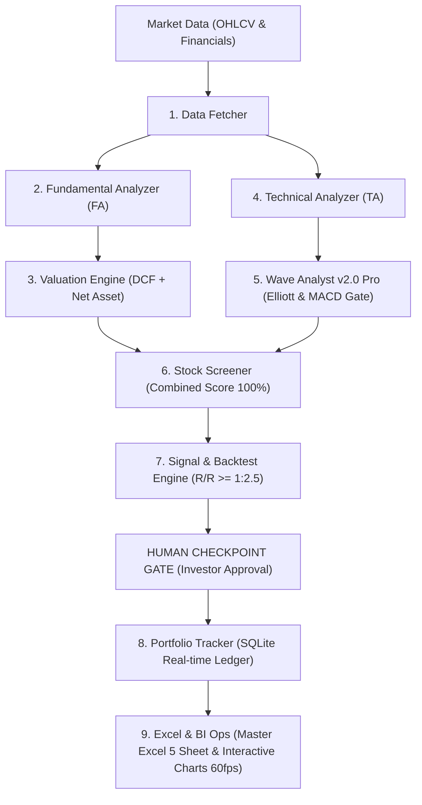

# AGY Investment Agentic Ecosystem (v3.0 Pro)
## Autonomous Multi-Agent System for Financial Analysis, Valuation, Elliott Wave & Portfolio Management

[](https://www.python.org/downloads/)
[](https://www.tradingview.com/)
[](LICENSE)
[](#)

---

## 🌟 Overview
**AGY Investment Agent** is a production-grade, multi-agent financial intelligence ecosystem designed for **Vietnamese Equities (HOSE/HNX), Gold (XAUUSD), Cryptocurrencies (BTC/ETH), and Global Macro Assets**.

Built on the **Fsen Internal Investment Methodology**, the system harmonizes 4 quantitative pillars:
1. **Fundamental Analysis (FA 30%):** 5-year financial statement audits, 3 warning light gates, and 7 durable economic moats.
2. **Dual Valuation (Valuation 30%):** 10-year Discounted Cash Flow (DCF) model coupled with Net Asset Value (NAV) with non-interest liability stripping (Margin of Safety $\ge 25\%$).
3. **Technical Analysis (TA 25%):** 6 Fsen Technical Pillars, Trendlines, Dynamic Channels, MA10/20/50, and Price Action.
4. **Elliott Wave & Cycle Forecasting (Wave 15%):** 5 impulse waves (1-2-3-4-5) & 4 corrective wave families (Zigzag 5-3-5, Flat 3-3-5, Triangle 3-3-3-3-3, Complex W-X-Y), integrated with the **Fsen MACD Bulltrap & C-Wave Exhaustion Gate**.

---

## 🏛️ System Architecture



---

## 🚀 Key Features

- **Dynamic Corrective Wave Engine:** Automatically detects and classifies Zigzag (Regular/Extended/Running), Flat (Regular/Expanded Bulltrap/Running), Contracting Triangles, and Double Zigzags (W-X-Y).
- **Fsen MACD Bulltrap Filter:** Detects bearish divergence when price breaks swing highs to identify Wave B margin bulltraps.
- **C-Wave Exhaustion Hunter:** Detects bullish divergence at Wave C bottoms to trigger Sniper Entries for new Wave 1 kicks.
- **3-Pillar Future Projection:** Delivers Pattern Forecast, Fibonacci Amplitude (PRZ Zones, Invalidation Level), and Fibonacci Time Cycle dates.
- **Interactive Web Chart (60fps):** Real-time standalone and master chart powered by Lightweight Charts with HUD overlay and future wave paths.
- **TradingView Pine Script v6:** Packaged with Top-Left Projection Box and HUD Table (`AGY_Fsen_Elliott_Scanner.pine`).
- **OpenAI Codex & ChatGPT Ready:** Comes with full configuration prompts and instructions for Custom GPTs and AI coding assistants.

---

## 📦 Quick Start

### 1. Installation
Clone this repository and install the dependencies:
```bash
git clone https://github.com/your-username/agy-investment-agent.git
cd agy-investment-agent
pip install -r requirements.txt
```

### 2. 1-Click Pipeline Execution
Run the full 3-phase automated investment pipeline:
- **Windows:** Double-click `CHAY_KIEM_THU_TOAN_BO_PIPELINE.bat`
- **Command Line:**
  ```bash
  python run_full_investment_pipeline.py
  ```

### 3. Launch Interactive Charts
- Double-click `MO_BIEU_DO_WEB.bat` to launch the local web server and open:
  `http://localhost:8888/chart_scenario_interactive_MASTER.html`

### 4. Install TradingView Indicator
- Double-click `MO_TRADINGVIEW_PINE_EDITOR.bat` to automatically load the 25,000+ char Pine Script v6 into your clipboard, open TradingView, and paste into the Pine Editor.

---

## 🤖 Using with OpenAI Codex / ChatGPT
Refer to [`CODEX_CHATGPT_INSTRUCTIONS.md`](CODEX_CHATGPT_INSTRUCTIONS.md) for the complete Master System Prompt, Custom GPTs configuration, and prompt templates.

---

## 📄 License
This project is licensed under the MIT License - see the [LICENSE](LICENSE) file for details.
